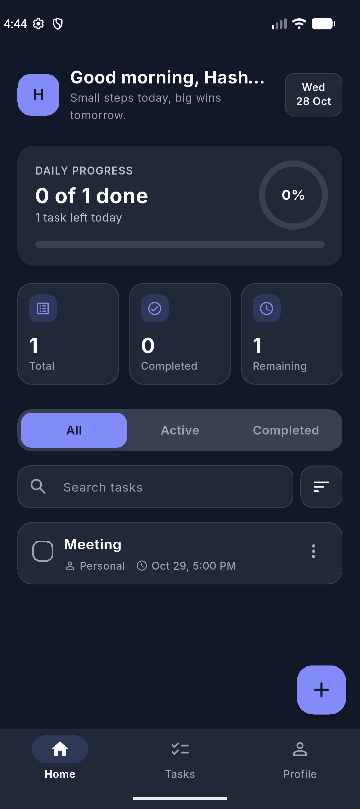
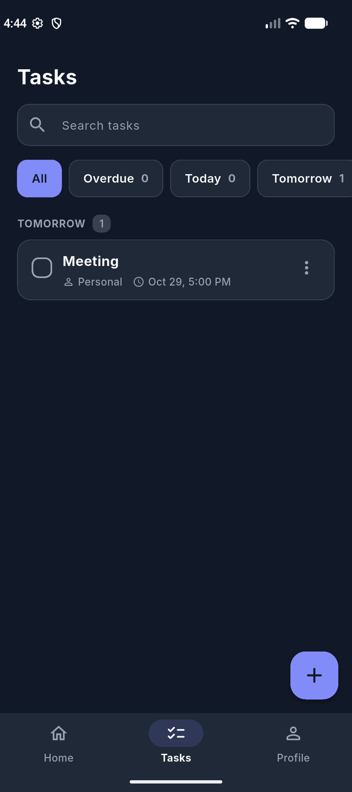
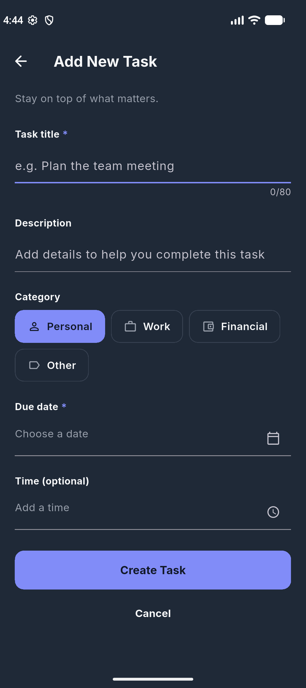
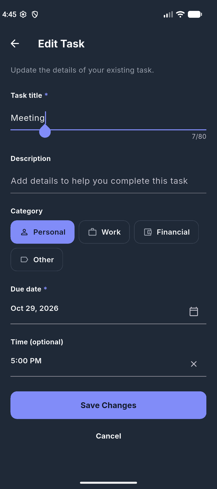
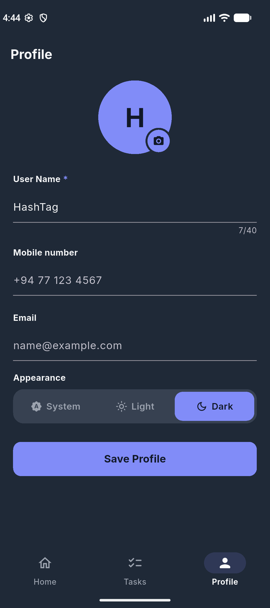

# TaskFlow

A Flutter to-do app with task categories, due dates and times, multiple profiles, and light/dark themes. Tasks are stored locally in SQLite and state is managed with Provider.

## Screenshots

| Home | Tasks | Add Task |
| :---: | :---: | :---: |
|  |  |  |

| Edit Task | Completed | Profile |
| :---: | :---: | :---: |
|  |  |  |

## Features

- Add, edit, and delete tasks with a due date and time
- Organize tasks by category
- Separate tabs for active and completed tasks
- Multiple profiles
- Light and dark themes
- Local persistence with SQLite

## Getting Started

```bash
flutter pub get
flutter run
```

Run the tests with:

```bash
flutter test
```
